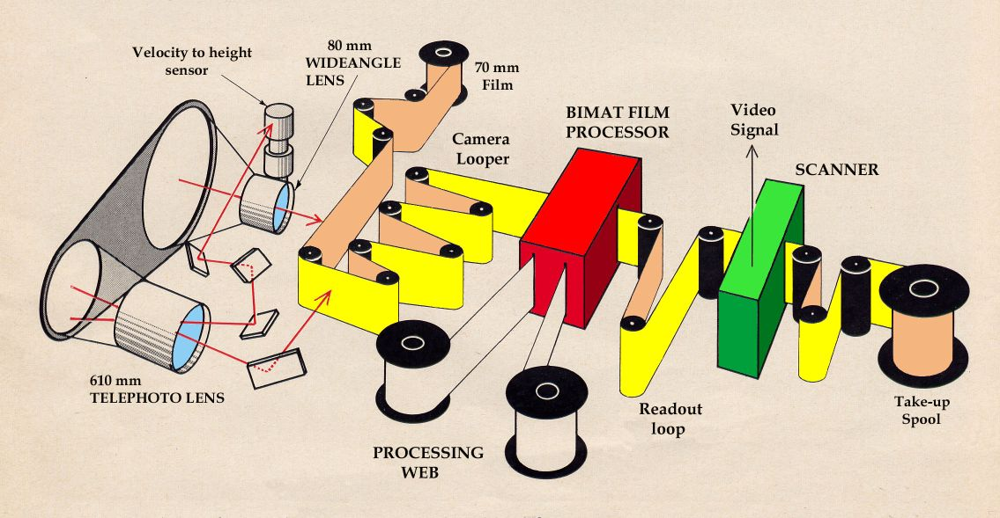

# Lunar orbiter
- analog ale s twistem.
- 5 modulů s úkolem naskenovat povrch Měsíce. To se podařilo a naskenovali 99 % celého povrchu s detailností na **1** metr.
- Každý modul měl na palubě **79 metrů 70mm** filmu. Tento film byl speciálně vyvinut pro velmi vysoké zrno a měl velmi nízké ISO (asi tak 3)
- Kvůli vysoké rychlosti orbitu kolem Měsíce se řešilo rozmazání pomocí speciálního přístroje. Tento přístroj vypočítal rychlost oběhu a poté upravoval rychlost odvíjení filmu čímž se rozmazání vyrušilo.
- Volání probíhalo pomocí role která byla namočena do velmi koncentrované vývojky a ustalovče. Ta se v jednom bodě přitiskla na roli s filmem a asi 3,5 minuty se dotýkaly, behěm nichž se film zároveň volal a ustaloval.
- Skenování probíhalo pomocí ultra tenkého paprsku světla (5 um široký, 1/20 lidského vlasu) který nasvicoval posouváním segment o šířce 2.2 mm. Každý 2,5 cm filmového pásu tak byl prosvícen asi **17 000**, během toho e film postupně dál odvíjel. Na druhé straně byl fotoelektrický článek. Jelikož film funguje na prosvicování, intenzita prošlého světla se měnila s tmavostí daných částí filmu. to poté bylo konvertováno jako **analogový** elektrický signál, posílaný rádiovými vlnami zpátky na Zem.

- Na Zemi se data příjmala a inverzně nasvítila na 35mm filmové pásky. Ty byly pak pověšeny vedle sebe. 
- Během tohoto skenování Měsíce (16. orbit) se provedl manévr k natočení se k Zemi. Snímek byl vyfocen oběma optikami.
