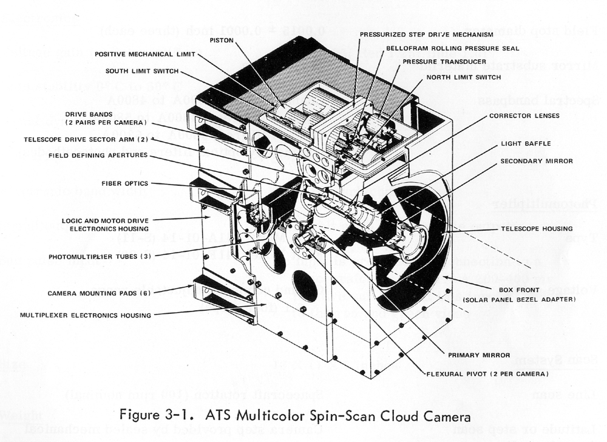

# SATELIT ATS-3
- Kamera přidělaná ze strany válcovitého tvaru satelitu. Vyfotilo to panorama fotku jedné linie. Potom se lehce naklonil objektiv na další řadu.
- První opravdu digitální snímek Země. Rozlišení 2400x2400 pixelů.
- Barevnost to řešilo pomocí rozdělení světla na 3 složky, které se pomocí FM signálu poslaly na Zem. Satelit se otáčel rychlostí 100 otáček/minutu. Celý proces focení Země trval 24 minut. 
- Prakticky ne foťák ale spíš hodně hi-tech 3 skenery.
- Rozlišení asi 4 km na px.
- Sice byl v provozu od 1967-2001 (34 let) ale 2 snímací elektronky selhaly už po 3 měsících, takže operoval prakticky celou dobu v černobílé.
 
